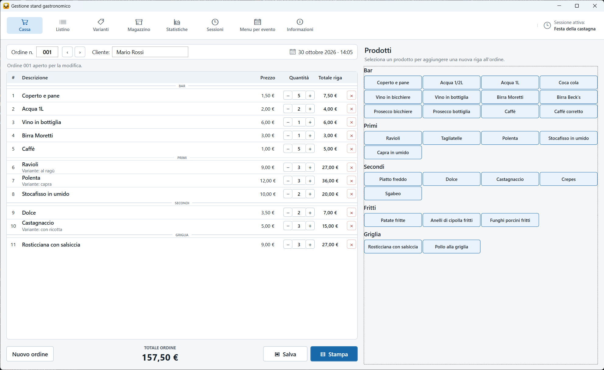
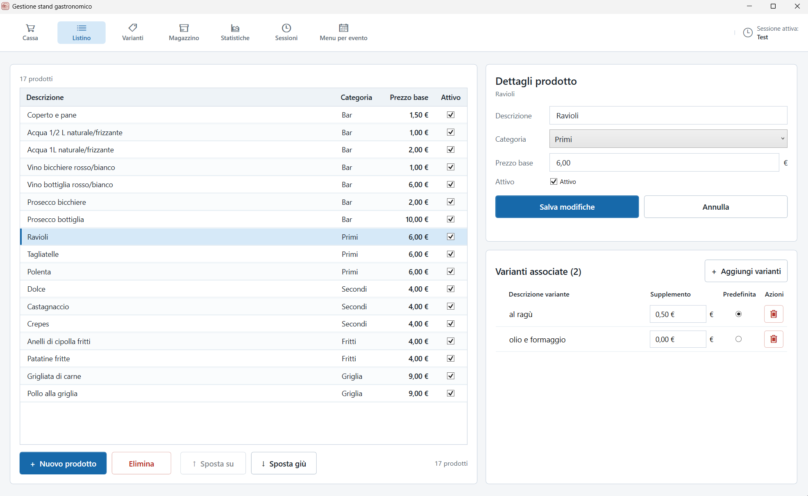
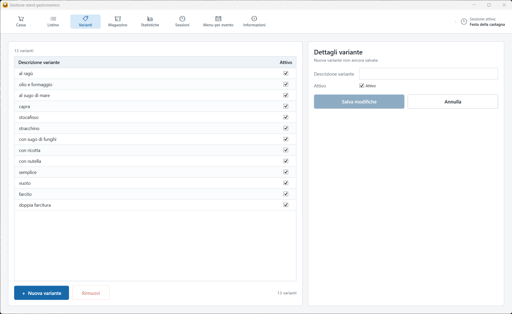
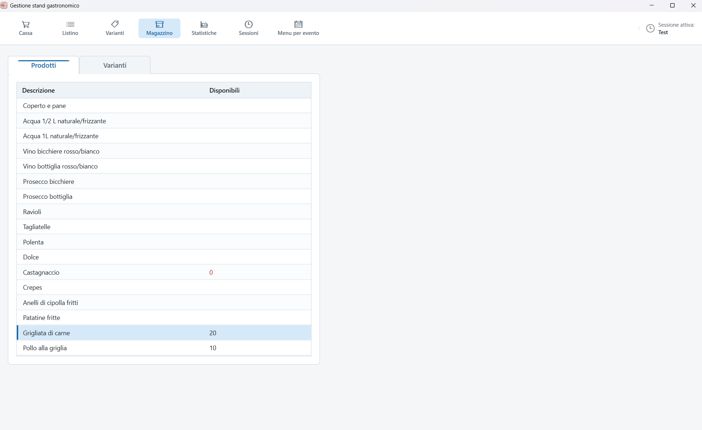
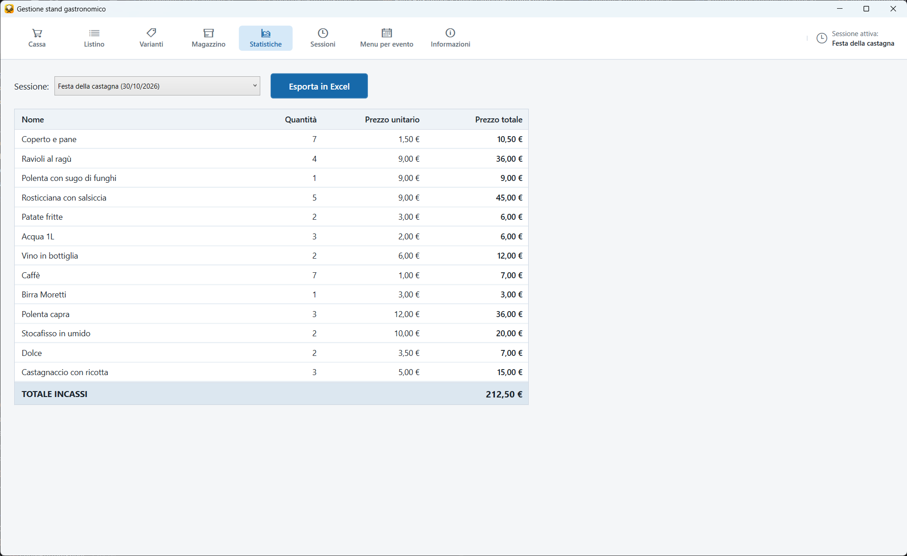
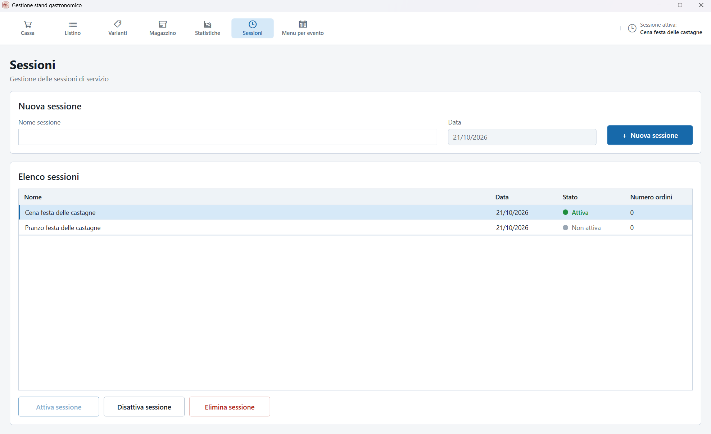
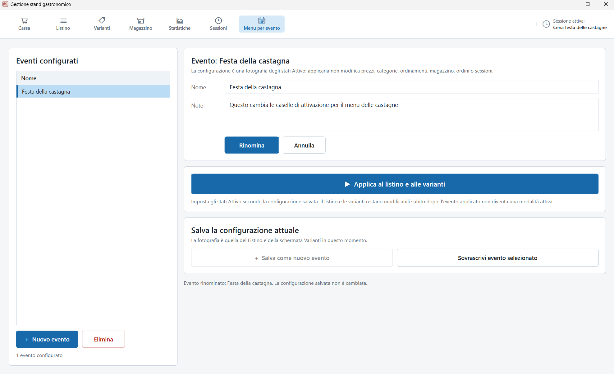

# 🍽️ Stand Gastronomico — Gestionale gratuito per sagre e feste

**Un programma gratuito e offline per Windows, pensato per associazioni, volontari e organizzatori di sagre, feste paesane ed eventi gastronomici.**

Stand Gastronomico è un'applicazione desktop per Windows pensata per associazioni, volontari e organizzatori di eventi gastronomici.

Permette di gestire gli ordini, il listino, le varianti, il magazzino e gli incassi attraverso un'interfaccia semplice e intuitiva.

È gratuito, funziona offline e non richiede abbonamenti o registrazioni.

---

## ✨ Funzionalità

- **Cassa:** crea, modifica e stampa gli ordini durante il servizio.
- **Listino:** gestisci prodotti, categorie, prezzi e disponibilità.
- **Varianti:** configura preparazioni alternative e relativi supplementi.
- **Magazzino:** controlla le porzioni disponibili e le movimentazioni delle scorte.
- **Statistiche:** consulta vendite e incassi ed esporta i dati in Excel.
- **Sessioni:** organizza i diversi turni di servizio e i relativi ordini.
- **Menu per evento:** salva e richiama configurazioni differenti dei prodotti e delle varianti disponibili.
- **Stampa ordini:** stampa gli ordini su fogli A4, con un layout personalizzabile.

## 🖥️ Screenshot

| Cassa | Listino |
|---|---|
|  |  |

| Varianti | Magazzino |
|---|---|
|  |  |

| Statistiche | Sessioni |
|---|---|
|  |  |

## 📥 Download

Scarica l'ultima versione disponibile dalla pagina [Releases](../../releases/latest).

Il programma viene distribuito in formato ZIP. Non è necessario installare l'applicazione: basta estrarre l'archivio in una cartella del computer e avviare `StandGastronomico.App.exe`.

## 💻 Requisiti

- Windows 10 o Windows 11 a 64 bit.
- Microsoft Edge WebView2 Runtime per la funzionalità di stampa.
- Una cartella nella quale l'utente abbia i permessi di scrittura.

Non è necessario installare .NET: il runtime è incluso nel programma.

Stand Gastronomico non richiede una connessione Internet per il normale funzionamento.

## 🚀 Installazione

1. Scarica l'archivio ZIP dalla sezione [Releases](../../releases/latest).
2. Estrai il contenuto in una cartella del computer, ad esempio `C:\StandGastronomico`.
3. Avvia `StandGastronomico.App.exe`.
4. Se necessario, crea un collegamento sul desktop per raggiungere rapidamente il programma.

**Importante:** evita di estrarre il programma in cartelle protette di Windows, come `Program Files`, se non disponi dei necessari permessi di scrittura.

## 🔄 Aggiornamento

Per aggiornare il programma:

1. Effettua una copia di sicurezza della cartella `Data`.
2. Scarica la nuova versione dalla sezione Releases.
3. Sostituisci i file dell'applicazione con quelli della nuova versione.

**Non sovrascrivere le cartelle `Data`, `Logs` e `Config`.**

La cartella `Data` contiene il database con ordini, prodotti, sessioni e statistiche. La cartella `Config` contiene le personalizzazioni effettuate dall'utente.

## ⚙️ Personalizzazione

Stand Gastronomico permette di personalizzare alcuni aspetti senza modificare il programma:

- Le etichette delle cinque categorie, attraverso `Config/categories.json`.
- Il layout e i contenuti della stampa degli ordini, attraverso i file HTML e CSS presenti in `Config/Print`.

Le modifiche non richiedono di ricompilare l'applicazione.

Per maggiori informazioni consulta la [guida alla configurazione](docs/CONFIGURAZIONE.md).

## 📖 Documentazione

- [Guida utente](GUIDA_UTENTE.pdf)
- [Personalizzazione e configurazione](docs/CONFIGURAZIONE.md)
- [Personalizzazione dei template di stampa](docs/TEMPLATE_STAMPA.md)
- [Cronologia delle versioni](CHANGELOG.md)

## 🔒 Privacy

Stand Gastronomico è progettato per funzionare localmente sul computer.

- Non richiede account o registrazioni.
- Non invia i dati degli ordini a servizi esterni.
- Non utilizza sistemi di telemetria o raccolta di statistiche sull'utilizzo.
- I dati dell'applicazione rimangono sul computer dell'utente.

## 💬 Supporto e contributi

Hai trovato un problema o vuoi segnalare un malfunzionamento?

Apri una [segnalazione](../../issues).

Vuoi condividere un'esperienza, lasciare un suggerimento o semplicemente ringraziare per il progetto?

Puoi partecipare alle [Discussioni](../../discussions).

## ❤️ Sostieni il progetto

Stand Gastronomico è gratuito e rimarrà gratuito.

Se il programma ti è utile e desideri sostenere il suo sviluppo, puoi offrire un contributo volontario tramite [PayPal](https://paypal.me/LucaFigoli).

Il contributo è completamente facoltativo e non dà diritto a funzionalità aggiuntive.

## 📜 Licenza

Stand Gastronomico è distribuito secondo i termini della licenza proprietaria gratuita inclusa nel file [LICENSE](LICENSE).

È consentito utilizzare e ridistribuire gratuitamente il programma compilato nel rispetto delle condizioni indicate nella licenza. Il codice sorgente non è distribuito.

---

**Stand Gastronomico**  
Sviluppato da **TizioIncognito**.
